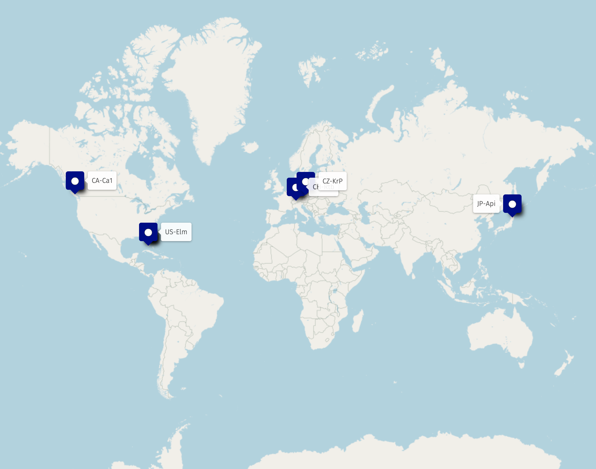

# C1. Site overview

```{=html}
<style>
.table-responsive { overflow-x: auto; }
.site-overview table {
  width: 1500px;
  table-layout: fixed;
}
.site-overview th:nth-child(1), .site-overview td:nth-child(1) { width: 90px; }
.site-overview th:nth-child(2), .site-overview td:nth-child(2) { width: 230px; }
.site-overview th:nth-child(3), .site-overview td:nth-child(3) { width: 70px; }
.site-overview th:nth-child(4), .site-overview td:nth-child(4) { width: 80px; }
.site-overview th:nth-child(5), .site-overview td:nth-child(5) { width: 90px; }
.site-overview th:nth-child(6), .site-overview td:nth-child(6) { width: 90px; }
.site-overview th:nth-child(7), .site-overview td:nth-child(7) { width: 100px; }
.site-overview th:nth-child(8), .site-overview td:nth-child(8) { width: 100px; }
.site-overview th:nth-child(9), .site-overview td:nth-child(9) { width: 100px; }
.site-overview th:nth-child(10), .site-overview td:nth-child(10) {
  width: 550px;
  overflow-wrap: anywhere;
}
</style>
```

::: {.table-responsive .site-overview}
| Site ID | Name | Country | IGBP | Latitude | Longitude | First year | Last year | Hub | Data citation |
|--------|--------|--------|--------|-------:|-------:|-------:|-------:|--------|--------|
| JP-Api | Appi forest meteorology research site | JP | DBF | 40.001358 | 140.93658 | 2000 | 2022 | ICOS | (2026). Fluxnet Archive Product from Appi forest meteorology research site, 2000–2022, FLUXNET, <https://hdl.handle.net/11676/6FLIvFghC2kn5jdWiKfUjx9S> |
| CA-Ca1 | British Columbia - 1949 Douglas-fir stand | CA | ENF | 49.8673 | -125.3336 | 1997 | 2010 | AmeriFlux | T. Andrew Black (2025), AmeriFlux FLUXNET-1F CA-Ca1 British Columbia - 1949 Douglas-fir stand, Ver. v1.3_r1, AmeriFlux AMP, (Dataset). <https://doi.org/10.17190/AMF/2007163> |
| CH-Rtb | Rietholzbach | CH | GRA | 47.3804 | 8.9934 | 2009 | 2022 | ICOS | Hirschi, M., Michel, D., Seneviratne, S. (2026). Fluxnet Archive Product from Rietholzbach, 2009–2022, FLUXNET, <https://hdl.handle.net/11676/ZSw7OruD5oGCPKwcw5aAC563> |
| CZ-KrP | Kresin u Pacova | CZ | CRO | 49.573257 | 15.078773 | 2014 | 2023 | ICOS | Acosta, M., Czerný, R. (2026). Fluxnet Archive Product from Kresin u Pacova, 2014–2023, FLUXNET, <https://hdl.handle.net/11676/cqH_ifs_P83CsahNQXGTp3Im> |
| US-Elm | Everglades (long hydroperiod marsh) | US | WET | 25.5519 | -80.7826 | 2008 | 2024 | AmeriFlux | Gregory Starr, Steve Oberbauer (2026), AmeriFlux FLUXNET-1F US-Elm Everglades (long hydroperiod marsh), Ver. v1.3_r1, AmeriFlux AMP, (Dataset). <https://doi.org/10.17190/AMF/2007169> |
:::

{fig-align="center"}

## C2. Data coverage

```{r}
knitr::opts_knit$set(root.dir = normalizePath("..", mustWork = TRUE))

```

```{r}
zip_files <- list.files("data/raw", pattern = "\\.zip$", full.names = TRUE)
if (length(zip_files) == 0) {
  stop("No FLUXNET ZIP archives found in data/raw.")
}

dir.create("data/raw/unzipped", recursive = TRUE, showWarnings = FALSE)
for (zip_file in zip_files) {
  hh_files <- grep(
    "FLUXMET_HH",
    unzip(zip_file, list = TRUE)$Name,
    value = TRUE
  )
  dd_files <- grep(
    "FLUXMET_DD",
    unzip(zip_file, list = TRUE)$Name,
    value = TRUE
  )
  if (length(hh_files) != 1) {
    stop("Expected one FLUXMET_HH file in ", basename(zip_file),
         "; found ", length(hh_files), ".")
  }
  if (length(dd_files) != 1) {
    stop("Expected one FLUXMET_DD file in ", basename(zip_file),
         "; found ", length(dd_files), ".")
  }
  unzip(zip_file, files = hh_files, exdir = "data/raw/unzipped")
  unzip(zip_file, files = dd_files, exdir = "data/raw/unzipped")
}
```

```{r}
library(readr)
library(dplyr)

keep <- c("TIMESTAMP_START", "TIMESTAMP_END", "TA_F", "SW_IN_F", "VPD_F", "P_F",
          "NETRAD", "G_F_MDS", "H_F_MDS", "H_F_MDS_QC", "LE_F_MDS", "LE_F_MDS_QC",
          "NEE_VUT_REF", "NEE_VUT_REF_QC", "GPP_NT_VUT_REF", "RECO_NT_VUT_REF")

FLUXNET_HHs <- list.files(
  "data/raw/unzipped",
  pattern = "FLUXMET_HH.*\\.csv$",
  recursive = TRUE,
  full.names = TRUE
)

read_hh <- function(file) {
  read_csv(
    file,
    na = "-9999",
    col_select = any_of(keep),
    col_types = cols(
      TIMESTAMP_START = "c",
      TIMESTAMP_END = "c",
      .default = "d"
    )
  ) |>
    mutate(time = as.POSIXct(TIMESTAMP_START, format = "%Y%m%d%H%M", tz = "UTC"))
}

site_ids <- sub(
  ".*_([^_]+)_FLUXNET_FLUXMET_HH.*\\.csv$",
  "\\1",
  basename(FLUXNET_HHs)
)

if (length(FLUXNET_HHs) != 5 || anyDuplicated(site_ids)) {
  stop(
    "Expected one FLUXMET_HH file for each of the five sites; found: ",
    paste(basename(FLUXNET_HHs), collapse = ", ")
  )
}

flux_data <- setNames(lapply(FLUXNET_HHs, read_hh), site_ids)
```

### Annual NEE coverage

```{r}
library(ggplot2)

coverage <- bind_rows(flux_data, .id = "site") |>
  mutate(year = as.integer(format(time, "%Y"))) |>
  filter(!is.na(year)) |>
  group_by(site, year) |>
  summarise(
    share_measured = sum(NEE_VUT_REF_QC == 0, na.rm = TRUE) / n(),
    .groups = "drop"
  )

ggplot(coverage, aes(x = year, y = site, fill = share_measured)) +
  geom_tile(color = "white") +
  scale_fill_gradient(
    low = "#f7fbff",
    high = "#084594",
    limits = c(0, 1),
    labels = function(x) paste0(round(x * 100), "%"),
    name = "Measured NEE"
  ) +
  labs(
    title = "Annual share of half-hours with measured NEE",
    x = "Year",
    y = "Site"
  ) +
  theme_minimal() +
  theme(axis.text.x = element_text(angle = 45, hjust = 1))

best_coverage <- coverage |>
  filter(share_measured == max(share_measured))

cat(
  "The best NEE data coverage was at ",
  paste(paste(best_coverage$site, best_coverage$year, sep = " in "), collapse = ", "),
  ", with ",
  round(max(coverage$share_measured) * 100, 1),
  "% of half-hours measured.",
  sep = ""
)
```

## C3. Summary statistics

```{r}
#| results: asis
summary_variables <- c(
  TA_F = "TA_F (°C)",
  SW_IN_F = "SW_IN_F (W m-2)",
  VPD_F = "VPD_F (kPa)",
  P_F = "P_F (mm)",
  NEE_VUT_REF = "NEE_VUT_REF (µmol CO2 m-2 s-1)",
  GPP_NT_VUT_REF = "GPP_NT_VUT_REF (µmol CO2 m-2 s-1)",
  RECO_NT_VUT_REF = "RECO_NT_VUT_REF (µmol CO2 m-2 s-1)",
  H_F_MDS = "H_F_MDS (W m-2)",
  LE_F_MDS = "LE_F_MDS (W m-2)"
)

site_summary <- bind_rows(lapply(names(flux_data), function(site) {
  dat <- flux_data[[site]]

  bind_rows(lapply(names(summary_variables), function(variable) {
    values <- dat[[variable]]
    missing_percent <- mean(is.na(values)) * 100

    if (variable == "P_F") {
      annual_values <- dat |>
        mutate(year = as.integer(format(time, "%Y"))) |>
        filter(!is.na(year)) |>
        group_by(year) |>
        summarise(
          annual_total = if (all(is.na(P_F))) NA_real_ else sum(P_F, na.rm = TRUE),
          .groups = "drop"
        ) |>
        filter(!is.na(annual_total)) |>
        pull(annual_total)

      mean_value <- if (length(annual_values) == 0) NA_real_ else mean(annual_values)
    } else {
      mean_value <- mean(values, na.rm = TRUE)
      if (is.nan(mean_value)) mean_value <- NA_real_
    }

    tibble(
      Site = site,
      Variable = unname(summary_variables[[variable]]),
      Mean = mean_value,
      Minimum = if (all(is.na(values))) NA_real_ else min(values, na.rm = TRUE),
      Maximum = if (all(is.na(values))) NA_real_ else max(values, na.rm = TRUE),
      `Missing (%)` = missing_percent
    )
  }))
})) |>
  mutate(across(c(Mean, Minimum, Maximum, `Missing (%)`), ~ round(.x, 2)))

for (site in unique(site_summary$Site)) {
  cat("\n\n### ", site, "\n\n", sep = "")

  site_table <- site_summary |>
    filter(Site == site) |>
    select(-Site)

  print(knitr::kable(
    site_table,
    format = "html",
    caption = paste(
      "Summary statistics for", site,
      "(P_F mean is the mean annual precipitation total)"
    ),
    align = c("l", "r", "r", "r", "r")
  ))
}
```

## C4. Time series

```{r}
library(tidyr)
library(ggplot2)

daily_flux <- bind_rows(lapply(names(flux_data), function(site) {
  flux_data[[site]] |>
    mutate(
      site = site,
      date = as.Date(time)
    ) |>
    group_by(site, date) |>
    summarise(
      across(
        c(NEE_VUT_REF, GPP_NT_VUT_REF, RECO_NT_VUT_REF),
        ~ if (all(is.na(.x))) NA_real_ else mean(.x, na.rm = TRUE)
      ),
      .groups = "drop"
    )
})) |>
  mutate(
    across(
      c(NEE_VUT_REF, GPP_NT_VUT_REF, RECO_NT_VUT_REF),
      ~ .x * 1.0378
    )
  ) |>
  pivot_longer(
    cols = c(NEE_VUT_REF, GPP_NT_VUT_REF, RECO_NT_VUT_REF),
    names_to = "flux",
    values_to = "flux_gC_m2_d"
  ) |>
  mutate(
    flux = recode(
      flux,
      NEE_VUT_REF = "NEE",
      GPP_NT_VUT_REF = "GPP",
      RECO_NT_VUT_REF = "RECO"
    )
  )

ggplot(daily_flux, aes(x = date, y = flux_gC_m2_d, colour = flux)) +
  geom_line(na.rm = TRUE, linewidth = 0.25) +
  facet_wrap(~ site, ncol = 1, scales = "free_y") +
  labs(
    title = "Daily NEE, GPP and RECO",
    x = "Date",
    y = "Carbon flux (g C m-2 d-1)",
    colour = "Flux"
  ) +
  theme_minimal()
```

### Check against the daily FLUXMET_DD file

```{r}
dd_files <- list.files(
  "data/raw/unzipped",
  pattern = "FLUXMET_DD.*\\.csv$",
  recursive = TRUE,
  full.names = TRUE
)

check_site <- names(flux_data)[1]
check_file <- dd_files[
  grepl(
    paste0("_", check_site, "_"),
    basename(dd_files),
    fixed = TRUE
  )
]

if (length(check_file) == 0) {
  stop(
    "Could not identify a FLUXMET_DD file for ", check_site,
    ". Available files: ", paste(basename(dd_files), collapse = ", ")
  )
}

daily_archive <- read_csv(
  check_file[[1]],
  na = "-9999",
  col_select = any_of(c(
    "TIMESTAMP", "NEE_VUT_REF", "GPP_NT_VUT_REF", "RECO_NT_VUT_REF"
  )),
  col_types = cols(.default = "d", TIMESTAMP = "c")
) |>
  mutate(date = as.Date(TIMESTAMP, format = "%Y%m%d"))

daily_check <- daily_flux |>
  filter(site == check_site) |>
  select(date, flux, flux_gC_m2_d) |>
  pivot_wider(names_from = flux, values_from = flux_gC_m2_d) |>
  inner_join(
    daily_archive |>
      mutate(across(
        c(NEE_VUT_REF, GPP_NT_VUT_REF, RECO_NT_VUT_REF),
        ~ .x * 1.0378
      )) |>
      select(
        date,
        NEE = NEE_VUT_REF,
        GPP = GPP_NT_VUT_REF,
        RECO = RECO_NT_VUT_REF
      ),
    by = "date",
    suffix = c("_aggregated", "_archive")
  )

check_summary <- bind_rows(lapply(
  c("NEE", "GPP", "RECO"),
  function(variable) {
    aggregated <- daily_check[[paste0(variable, "_aggregated")]]
    archive <- daily_check[[paste0(variable, "_archive")]]
    keep <- complete.cases(aggregated, archive)

    tibble(
      Site = check_site,
      Flux = variable,
      Days_compared = sum(keep),
      Mean_absolute_difference = if (any(keep)) {
        mean(abs(aggregated[keep] - archive[keep]))
      } else {
        NA_real_
      }
    )
  }
))

knitr::kable(
  check_summary,
  digits = 4,
  caption = paste("Aggregation check against FLUXMET_DD for", check_site)
)
```

## C5. Diurnal cycles

Seasons are assigned from each site's latitude: sites north of the equator use December–February (winter), March–May (spring), June–August (summer), and September–November (autumn). For sites south of the equator, these seasons are reversed. The hour of day is taken from `TIMESTAMP_START` as recorded in the FLUXNET file.

```{r}
library(tidyr)
library(ggplot2)

site_latitudes <- read_csv(
  "tower_sets_block4.csv",
  show_col_types = FALSE
) |>
  filter(site_id %in% names(flux_data)) |>
  distinct(site_id, lat)

if (nrow(site_latitudes) != length(flux_data)) {
  stop("Could not find one latitude for each site in tower_sets_block4.csv.")
}

latitude_by_site <- setNames(site_latitudes$lat, site_latitudes$site_id)

diurnal_data <- bind_rows(lapply(names(flux_data), function(site) {
  site_latitude <- latitude_by_site[[site]]
  site_hemisphere <- if (site_latitude >= 0) "north" else "south"

  flux_data[[site]] |>
    mutate(
      site = site,
      month = as.integer(substr(TIMESTAMP_START, 5, 6)),
      hour = as.integer(substr(TIMESTAMP_START, 9, 10)),
      hemisphere = site_hemisphere,
      season = case_when(
        month %in% c(12, 1, 2) & hemisphere == "north" ~ "Winter",
        month %in% c(3, 4, 5) & hemisphere == "north" ~ "Spring",
        month %in% c(6, 7, 8) & hemisphere == "north" ~ "Summer",
        month %in% c(9, 10, 11) & hemisphere == "north" ~ "Autumn",
        month %in% c(12, 1, 2) & hemisphere == "south" ~ "Summer",
        month %in% c(3, 4, 5) & hemisphere == "south" ~ "Autumn",
        month %in% c(6, 7, 8) & hemisphere == "south" ~ "Winter",
        month %in% c(9, 10, 11) & hemisphere == "south" ~ "Spring",
        TRUE ~ NA_character_
      )
    ) |>
    select(site, season, hour, NEE_VUT_REF, LE_F_MDS)
})) |>
  pivot_longer(
    cols = c(NEE_VUT_REF, LE_F_MDS),
    names_to = "variable",
    values_to = "flux"
  ) |>
  filter(!is.na(season), !is.na(hour)) |>
  group_by(site, variable, season, hour) |>
  summarise(
    mean_flux = if (all(is.na(flux))) NA_real_ else mean(flux, na.rm = TRUE),
    .groups = "drop"
  ) |>
  mutate(
    season = factor(season, levels = c("Spring", "Summer", "Autumn", "Winter")),
    variable = factor(
      variable,
      levels = c("NEE_VUT_REF", "LE_F_MDS"),
      labels = c("NEE (µmol CO2 m-2 s-1)", "LE (W m-2)")
    )
  )

ggplot(diurnal_data, aes(x = hour, y = mean_flux, colour = season, group = season)) +
  geom_line(na.rm = TRUE, linewidth = 0.7) +
  facet_grid(site ~ variable, scales = "free_y") +
  scale_x_continuous(breaks = seq(0, 23, by = 3), limits = c(0, 23)) +
  labs(
    title = "Mean seasonal diurnal cycles of NEE and LE",
    x = "Hour of day",
    y = "Mean flux",
    colour = "Season"
  ) +
  theme_minimal() +
  theme(legend.position = "bottom")
```

## C6. Energy balance and tower comparison

### Energy balance at CA-Ca1

The energy-balance comparison uses only half-hours where both sensible and latent heat fluxes have quality flag 0 (measured), and all four fluxes are available. The dashed line is the 1:1 reference; the solid line is the fitted linear relationship.

```{r}
energy_site <- "CA-Ca1"
energy_data <- flux_data[[energy_site]] |>
  filter(
    H_F_MDS_QC == 0,
    LE_F_MDS_QC == 0,
    complete.cases(H_F_MDS, LE_F_MDS, NETRAD, G_F_MDS)
  ) |>
  transmute(
    available_energy = NETRAD - G_F_MDS,
    turbulent_flux = H_F_MDS + LE_F_MDS
  )

if (nrow(energy_data) < 2) {
  stop("Not enough measured, complete energy-balance data for ", energy_site, ".")
}

energy_fit <- lm(turbulent_flux ~ available_energy, data = energy_data)
energy_slope <- unname(coef(energy_fit)[["available_energy"]])

ggplot(energy_data, aes(x = available_energy, y = turbulent_flux)) +
  geom_point(alpha = 0.2, size = 0.5) +
  geom_abline(
    slope = 1,
    intercept = 0,
    linetype = "dashed",
    colour = "grey40"
  ) +
  geom_smooth(method = "lm", formula = y ~ x, se = FALSE, colour = "#D55E00") +
  labs(
    title = paste("Energy balance:", energy_site),
    subtitle = sprintf(
      "Measured H and LE only (n = %s); fitted slope = %.3f",
      format(nrow(energy_data), big.mark = ","),
      energy_slope
    ),
    x = "Available energy: NETRAD - G_F_MDS (W m-2)",
    y = "Turbulent flux: H_F_MDS + LE_F_MDS (W m-2)"
  ) +
  coord_equal() +
  theme_minimal()
```

### Comparing the five towers

The annual uptake comparison uses annual sums of daily GPP, averaged across each site's available years. Seasonal cycle size is the difference between the largest and smallest seasonal mean daily GPP; seasons are assigned using each site's latitude as described in C5. The gap-filled share is calculated from `NEE_VUT_REF_QC`: flag 0 is treated as measured, and positive QC flags as gap-filled.

CA-Ca1 had the highest mean annual GPP, at 2561.6 g C m-2 yr-1 across its available years. CA-Ca1 had the largest seasonal GPP range, 9.96 g C m-2 d-1 between its highest and lowest seasonal means. I found CH-Rtb most surprising because its annual-uptake rank (2) differed most from its seasonal-cycle rank (4). The estimated gap-filled shares of NEE records were CA-Ca1 68.0%, US-Elm 31.0%, CH-Rtb 64.1%, CZ-KrP 51.2%, JP-Api 56.4%, based on positive NEE QC flags. At CA-Ca1, 26.8% of NEE records were flagged as measured (QC = 0), 68.0% as gap-filled (QC \> 0), and 5.3% had no QC value. These percentages describe NEE quality flags and should not be interpreted as measured/gap-filled fractions for GPP or RECO.

## Data and citation

### Site data products

- **JP-Api — Appi forest meteorology research site:** (2026). Fluxnet Archive Product from Appi forest meteorology research site, 2000–2022, FLUXNET. <https://hdl.handle.net/11676/6FLIvFghC2kn5jdWiKfUjx9S>
- **CA-Ca1 — British Columbia - 1949 Douglas-fir stand:** T. Andrew Black (2025), AmeriFlux FLUXNET-1F CA-Ca1 British Columbia - 1949 Douglas-fir stand, Ver. v1.3_r1, AmeriFlux AMP, (Dataset). <https://doi.org/10.17190/AMF/2007163>
- **CH-Rtb — Rietholzbach:** Hirschi, M., Michel, D., Seneviratne, S. (2026). Fluxnet Archive Product from Rietholzbach, 2009–2022, FLUXNET. <https://hdl.handle.net/11676/ZSw7OruD5oGCPKwcw5aAC563>
- **CZ-KrP — Kresin u Pacova:** Acosta, M., Czerný, R. (2026). Fluxnet Archive Product from Kresin u Pacova, 2014–2023, FLUXNET. <https://hdl.handle.net/11676/cqH_ifs_P83CsahNQXGTp3Im>
- **US-Elm — Everglades (long hydroperiod marsh):** Gregory Starr, Steve Oberbauer (2026), AmeriFlux FLUXNET-1F US-Elm Everglades (long hydroperiod marsh), Ver. v1.3_r1, AmeriFlux AMP, (Dataset). <https://doi.org/10.17190/AMF/2007169>

### FLUXNET reference

Pastorello et al. (2020). *The FLUXNET2015 dataset and the ONEFlux processing pipeline for eddy covariance data*. *Scientific Data*, 7, 225. <https://doi.org/10.1038/s41597-020-0534-3>

### FLUXNET acknowledgement

> FLUXNET data products were produced and harmonized by eddy covariance regional networks and data processing centers, including AmeriFlux, ChinaFlux, European Fluxes Database, ICOS, JapanFlux, KoFlux, OzFlux, SAEON, and TERN. These products also include a modified version of ERA5 hourly data provided by the Copernicus Climate Change Service.